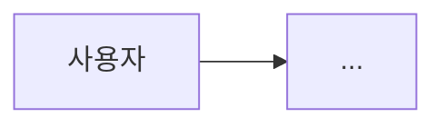

# 20. 아키텍처 분석

> 입력: 00-interpretation.md, 10-business-analysis.md, user/02, user/03.
> 모든 판단은 user/03 의 **품질 속성 우선순위**로 채점합니다.

## 1. 품질 속성 시나리오
| ID | 품질 속성 | 자극 (Stimulus) | 환경 | 기대 반응 | 측정 기준 | 출처 (NFR) |
|----|-----------|----------------|------|-----------|-----------|-----------|

## 2. 후보 아키텍처 비교
<!-- 최소 2개. 점수 = Σ(속성 점수 × 가중치), 가중치는 user/03 순위로 산정 -->
| 품질 속성 (가중치) | 후보 A: | 후보 B: | 후보 C: |
|--------------------|---------|---------|---------|
| 합계 | | | |

## 3. 선택 아키텍처
- 선택:
- 근거 (원칙 번호 인용):
- 포기한 것 (트레이드오프):

## 4. 컨텍스트 & 컴포넌트

| 컴포넌트 | 책임 | 기술 | 소유 팀 (예정) | 의존 |
|----------|------|------|----------------|------|

## 5. 주요 데이터 흐름 & 인터페이스
| 흐름 | 출발 → 도착 | 방식 (sync/async) | 계약 (API/이벤트 스키마) |
|------|-------------|-------------------|--------------------------|

## 6. 배포 & 인프라
- 환경:
- 배포 파이프라인 개요:
- 관측성:

## 7. 기술 스택 확정안
| 영역 | 기술 | 버전 | user/02·03 근거 |
|------|------|------|----------------|

## 8. ADR 목록
| ADR | 제목 | 상태 | 파일 |
|-----|------|------|------|
<!-- 각 ADR 은 workspace/project/adr/ADR-xxx.md -->

## 9. 아키텍처 리스크 & 기술 부채 예상
| ID | 리스크 | 확률 | 영향 | 대응 |
|----|--------|------|------|------|
