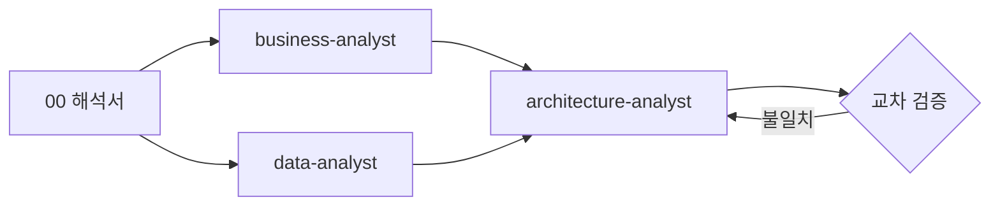
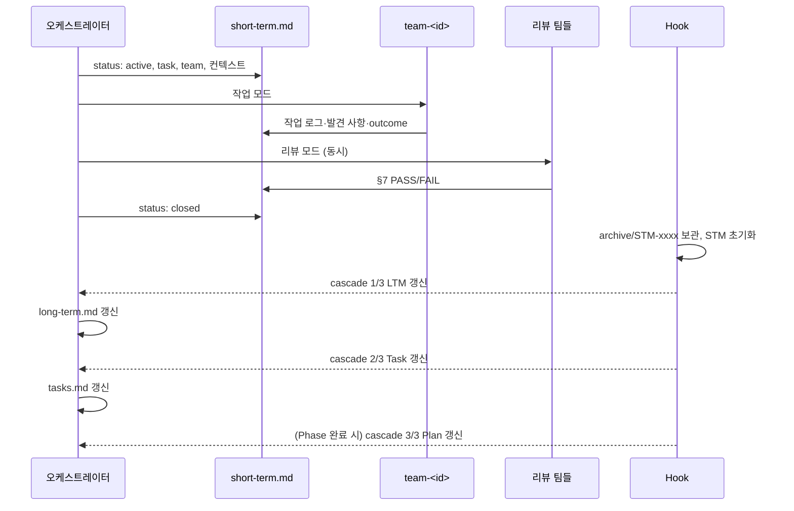

# 3. 파이프라인 단계별 설명

| 단계 | 명령 | 입력 | 출력 | 통과 조건 (Gate) |
|------|------|------|------|-----------------|
| 0 | `/aidlc-init` | 템플릿 | `workspace/` | — |
| 1 | `/aidlc-interpret` | user 4종 | `project/00-interpretation.md` | `check user` PASS, 판단 GO |
| 2 | `/aidlc-analyze` | 00 + user | `10` 비즈니스, `20` 아키텍처 + `adr/`, `30` EDA + `eda/` | 교차 검증 통과 |
| 3 | `/aidlc-teams` | 10·20·30 + 카탈로그 | `40` 팀 구성, `teams/<id>/charter.md`, `.claude/agents/team-<id>.md` | 필수 6팀 존재, 소유 범위 중복 없음 |
| 4 | `/aidlc-plan` | 00~40 + charter | `memory/plan.md`, `memory/tasks.md`, LTM 시드 | 모든 팀에 Task 배정 |
| 5 | `/aidlc-run [N]` | tasks + STM | 코드/산출물, `memory/archive/STM-*` | 리뷰 게이트 PASS, cascade 완료 |
| 6 | `/aidlc-docs` | 명세·코드·FR | `docs/api/`, `docs/guide/`, `docs/README.md` | `check docs` PASS |

`/aidlc-status` 는 어느 단계에서든 실행할 수 있습니다.

---

## 0. `/aidlc-init [--force]`
템플릿을 `workspace/` 로 복사합니다. 이미 있는 파일은 건너뛰며, `--force` 일 때만 덮어씁니다 (**작성한 문서가 사라지니 주의**).

## 1. `/aidlc-interpret`
1. `aidlc.py check user` 로 `{{ }}` 미작성 항목 검사 → FAIL 이면 중단
2. `doc-interpreter` Agent 가 해석서 작성
   - **요구사항 추적표** — 모든 FR/NFR/KPI 를 해석·분류·확신도(H/M/L)와 함께
   - **모호함·충돌** — 테스트 불가 수용 기준, NFR ↔ 철학 충돌, 금지 기술 사용, 측정 데이터 없는 KPI, FR 없는 범위 항목
   - **질문 목록**
3. **GO/HOLD 판단** — 확신도 L 인 Must FR 이나 미해결 충돌이 있으면 HOLD

## 2. `/aidlc-analyze [business|architecture|data]`

- **비즈니스(10)** — 가치 제안, Lean 캔버스, KPI 트리, 사용자 여정, 기능 우선순위(가치×노력), MVP, 권장 Phase
- **데이터(30)** — 소스 프로파일, 품질 5차원 평가, 분포/이상치, 분석 질문 답변, ERD, 파이프라인 계획. 분석 코드는 `project/eda/` 에 남고 수치는 실행 결과만 인용
- **아키텍처(20)** — 품질 속성 시나리오, 후보 2개 이상 가중 채점, 선택 근거(원칙 번호 인용), 컴포넌트·소유 팀, 데이터 흐름, 기술 스택, ADR
- **교차 검증** — 모든 FR 이 컴포넌트에 매핑되는지, 데이터 파이프라인이 아키텍처 저장소와 맞는지 (불일치 시 최대 2회 재작업)

## 3. `/aidlc-teams`
`team-architect` 가 [팀 카탈로그](04-teams.md)에서 필수 6팀을 만들고, 조건부 팀은 분석서 근거가 있을 때만 만듭니다. 만들지 않은 팀은 책임을 넘겨받을 팀을 적습니다.

## 4. `/aidlc-plan`
- **plan.md** — Phase 로드맵 (P1 = MVP), 종료 조건, 리스크
- **tasks.md** — `## P1 — 이름` 섹션 아래 `- [ ] T-001 [team] 제목 — FR | deps | DoD`
  - P1 앞쪽에는 필수 팀 기반 Task (스토리 상세화, 계약 초안, 테스트 전략, CI, SLO, 위협 모델)
  - 각 Phase 마지막에는 문서화 Task
- **long-term.md** — ADR 결정과 개발 표준 핵심을 초기 지식으로

## 5. `/aidlc-run [N | T-ID]`

- 반복 중 `outcome: blocked` 가 나오면 멈추고 사유를 보고합니다.
- 자세한 원리는 [5. 메모리 계층과 Hook](05-memory-and-hooks.md).

## 6. `/aidlc-docs [api|guide]`
API 를 찾아 REST API 레퍼런스를 자동 생성하고, API 가이드와 사용자 가이드를 씁니다. → [6. API 문서화](06-api-docs.md)
