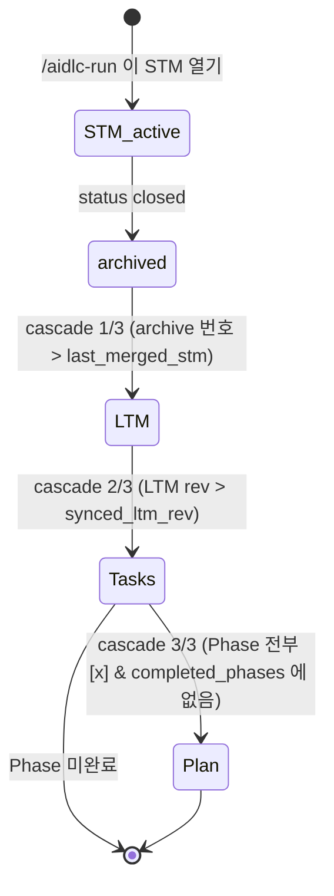

# 5. 메모리 계층과 Hook

## 4계층
| 계층 | 파일 | 수명 | 내용 | 언제 수정되나 |
|------|------|------|------|--------------|
| Plan | `plan.md` | 프로젝트 | Phase 로드맵, 종료 조건, 회고 | `/aidlc-plan`, cascade 3/3 |
| Tasks | `tasks.md` | Phase | 실행 단위 Task, 의존성, Blocked | `/aidlc-plan`, cascade 2/3 |
| Long-term (LTM) | `long-term.md` | 프로젝트 | 결정, 패턴, 이슈, 팀별 지식, 교훈, 용어 | cascade 1/3 |
| Short-term (STM) | `short-term.md` | Task 1개 | 목표, 컨텍스트, 작업 로그, 발견 사항, 결과, 리뷰 | 작업 중 |

**아래에서 위로 정제됩니다.** STM 의 날것의 기록 → LTM 의 재사용 지식 → Task 재조정 → Plan 재조정.

## 연쇄 갱신 (cascade)
Hook(`aidlc/hooks/memory_cascade.py`)이 **frontmatter 값만 보고** 다음 할 일을 결정합니다. LLM 의 판단에 맡기지 않으므로 항상 같은 결과가 나옵니다.



| 단계 | 조건 | Agent 가 할 일 | 끝났다고 판정되는 값 |
|------|------|---------------|---------------------|
| 보관 | STM `status: closed` | (Hook 이 자동) `archive/STM-0001_T-001.md` 로 이동, STM 초기화 | — |
| 1/3 LTM | 아카이브 번호 > LTM `last_merged_stm` | 아카이브를 읽고 LTM 에 병합 (중복 제거, 모순 시 취소선) | LTM `rev +1`, `last_merged_stm = 최신 번호` |
| 2/3 Tasks | LTM `rev` > tasks `synced_ltm_rev` | 완료 체크, 새 Task 추가, Blocked 이동, 재조정 | tasks `rev +1`, `synced_ltm_rev = LTM rev` |
| 3/3 Plan | `## P<n>` 의 체크박스 전부 `[x]` 이고 plan `completed_phases` 에 없음 | Phase 회고, 다음 Phase 조정 | plan `completed_phases` 에 추가, `current_phase` 이동 |

> 한 번에 **가장 아래 계층의 단계 하나**만 요구합니다. 1/3 이 끝나야 2/3 이 나옵니다.

## Hook 이벤트
| 이벤트 | 동작 |
|--------|------|
| `SessionStart` | 상태 요약(Plan/Task/LTM/STM, 미처리 cascade)을 Claude 컨텍스트에 주입. 진행 중 STM 이 있으면 이어서 하라고 안내 |
| `PostToolUse` (Write/Edit/MultiEdit) | 메모리 파일이 바뀌면 STM 보관 처리 + 다음 cascade 지시. OpenAPI 명세가 바뀌면 API 레퍼런스 재생성 안내 |
| `Stop` | 미처리 cascade 가 있으면 **종료 차단**하고 할 일을 지시. 연속 3회 차단 후에는 경고와 함께 종료 허용 (무한 루프 방지) |
| `PreCompact` | 컨텍스트 압축 직전 진행 중 STM 을 `archive/snapshots/` 에 저장 (cascade 대상 아님) |

`workspace/memory/` 가 없으면 모든 Hook 은 아무것도 하지 않습니다.

## frontmatter 사전
```yaml
# short-term.md
status: idle | active | closed
task: T-001
team: backend
outcome: none | done | partial | blocked
opened_at: 2026-10-23T10:00:00+09:00

# long-term.md
rev: 3                 # 병합할 때마다 +1
last_merged_stm: 5     # 마지막으로 병합한 STM 아카이브 번호

# tasks.md
rev: 4
synced_ltm_rev: 3      # 마지막으로 반영한 LTM rev

# plan.md
current_phase: P2
completed_phases: [P1]
```

## 직접 상태 보기
```bash
python3 aidlc/scripts/aidlc.py status
## AI-DLC 상태
- Plan: current_phase=P1, completed=[]
- Tasks: rev=1, synced_ltm_rev=0 | P1 0/7
- LTM: rev=0, last_merged_stm=0
- STM: status=idle, task=none, team=none
- STM 아카이브: 1건
- 미처리 cascade: ltm
```
