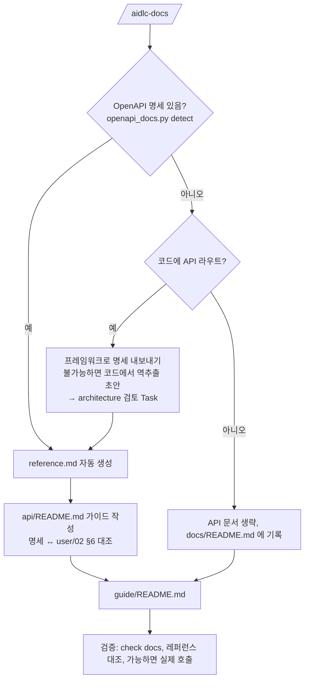

# 6. API 문서화 (REST)

`/aidlc-docs` 는 개발 중인 프로젝트에 **API 가 있으면** 자동으로 찾아 REST API 문서를 만듭니다.

| 산출물 | 만드는 방법 | 내용 |
|--------|------------|------|
| `docs/api/reference.md` | **자동 생성** (`openapi_docs.py`) — 직접 편집 금지 | 엔드포인트 목록, 인증, 파라미터·요청·응답 필드 표, JSON 예시, curl 예시, 스키마 |
| `docs/api/README.md` | Agent 작성 (템플릿 `aidlc/templates/docs/api-overview.md`) | 시작하기, 인증, 리소스 모델, RESTful 규약, 상태 코드, 에러, 페이지네이션, 멱등성, 한도, 버저닝 |
| `docs/guide/README.md` | Agent 작성 (템플릿 `aidlc/templates/docs/user-guide.md`) | 구현 완료된 기능의 사용자 가이드 |

👉 결과물 예시: [샘플 챗봇 API 레퍼런스](examples/reference.md) (원본 명세: `aidlc/examples/chatbot-openapi.json`)

---

## 동작 흐름



### API 탐지 규칙
1. **명세 파일** — 저장소 전체에서 `.json/.yaml/.yml` 중 앞부분에 `openapi: 3.x` 가 있는 파일 (`.git`, `node_modules`, `venv`, `dist`, `build` 제외)
2. **코드** — 명세가 없으면 라우트 패턴을 검색

| 프레임워크 | 탐지 패턴 | 명세 얻는 법 |
|-----------|-----------|-------------|
| FastAPI | `@app.get(`, `APIRouter(` | `json.dump(app.openapi(), open("openapi.json","w"))` |
| Flask | `@app.route(` | flask-smorest / apispec 등으로 생성, 없으면 역추출 |
| Express / NestJS | `router.get(`, `@Controller(` | NestJS `SwaggerModule.createDocument`, Express 는 swagger-jsdoc |
| Spring | `@RestController`, `@GetMapping` | springdoc-openapi `/v3/api-docs` |
| Django REST | `APIView`, `ViewSet` | drf-spectacular `manage.py spectacular` |
| Go | `gin.Default()`, `echo.New()` | swaggo, 없으면 역추출 |

> 명세의 정식 위치는 `workspace/project/contracts/` 이고 **architecture 팀이 소유**합니다. 코드에서 역추출한 명세는 초안으로 표시되고 architecture 검토 Task 가 생깁니다.

### 명세가 바뀌면
OpenAPI 명세 파일을 Write/Edit 하면 Hook 이 바로 알려 줍니다:
> `[AI-DLC docs] OpenAPI 명세가 변경되었습니다. 이 Task 를 마치기 전에 ... 레퍼런스를 다시 생성하세요.`

같은 Task 안에서 재생성까지 끝내는 것이 규칙입니다. docs 팀은 "공개 API 를 바꾸는 Task" 의 리뷰 게이트도 맡습니다.

---

## 직접 실행하기

```bash
# 1) 명세 찾기
python3 aidlc/scripts/openapi_docs.py detect
# aidlc/examples/chatbot-openapi.json

# 2) 레퍼런스 생성 (기본 출력: docs/api/reference.md)
python3 aidlc/scripts/openapi_docs.py render workspace/project/contracts/openapi.json
python3 aidlc/scripts/openapi_docs.py render aidlc/examples/chatbot-openapi.json -o docs/aidlc/examples

# 3) 문서 Gate
python3 aidlc/scripts/aidlc.py check docs
```

### reference.md 구성
| 섹션 | 명세에서 가져오는 것 |
|------|---------------------|
| 헤더 표 | `info.version`, `openapi`, `servers` |
| 인증 | `components.securitySchemes` |
| 엔드포인트 목록 | `paths` 를 첫 번째 `tags` 로 묶음, 각 항목은 상세로 가는 링크, deprecated 표시 |
| 엔드포인트 상세 | `summary`, `description`, 인증(전역/개별 `security`), `operationId` |
| 파라미터 | path 공통 + operation 파라미터 (`$ref` 해석), 타입·필수·설명 |
| 요청 본문 | 첫 번째 media type 의 스키마를 **중첩 필드 경로**(`message.id`, `sources[].score`)로 펼친 표 + JSON 예시 |
| 응답 | 상태 코드별 설명·본문 타입, 첫 2xx JSON 응답의 필드 표와 예시 |
| curl 예시 | 첫 번째 server URL, path 파라미터 예시값, 필수 query/header, 인증 헤더, JSON 본문 |
| 스키마 | `components.schemas` 전체 (`allOf` 병합) |

**예시 값 우선순위:** `example` → `examples` 첫 항목 → `default` → `enum` 첫 값 → 타입별 기본값 (`uuid`, `date-time`, `email`, `uri` 형식은 그럴듯한 값).

### 지원 범위와 제한
- OpenAPI **3.0 / 3.1** (3.1 의 `type: ["string","null"]` 지원). Swagger 2.0 은 변환 후 사용하세요.
- `$ref` 는 같은 문서 안(`#/...`)만 해석합니다. 외부 파일 참조는 "외부 참조" 로 표시됩니다.
- 중첩 필드는 4단계까지 펼칩니다.
- `oneOf`/`anyOf` 예시는 첫 번째 후보로 만듭니다.
- YAML 명세는 PyYAML 이 있어야 합니다 (`pip install pyyaml`). JSON 은 표준 라이브러리만 씁니다.

### 좋은 문서가 나오는 명세 작성 팁
- 모든 operation 에 `summary`(한 줄)와 `tags`(그룹) — 목록 표가 이것으로 만들어집니다.
- 필드마다 `description`, 대표 필드에는 `example` — 예시 JSON 과 curl 이 실제처럼 보입니다.
- 공통 파라미터·에러 응답은 `components.parameters` / `components.responses` 로 재사용.
- 에러는 하나의 `Error` 스키마로 통일하고 user/02 §6 포맷과 맞추세요.
- 폐기할 API 는 지우지 말고 `deprecated: true` 로.

---

## RESTful API 규약 정리

`docs/api/README.md`(API 가이드)는 아래 규약이 **이 API 에서 어떻게 적용되는지**를 설명합니다. 설계할 때도 이 기준으로 리뷰합니다 (architecture 리뷰 게이트).

### 1. 리소스 중심 URL
URL 은 **명사(리소스)**, 행위는 **HTTP 메서드**로 표현합니다.

| 좋음 | 나쁨 | 이유 |
|------|------|------|
| `GET /conversations` | `GET /getConversations` | 동사는 메서드가 표현 |
| `POST /conversations/{id}/messages` | `POST /sendMessage?conv=1` | 계층 관계를 경로로 |
| `GET /conversations?status=open` | `GET /openConversations` | 필터는 query 로 |
| `DELETE /conversations/{id}` | `POST /conversations/{id}/delete` | 삭제는 DELETE |
| `/faq-items` (kebab-case, 복수형) | `/FAQItem` | 일관된 네이밍 |

> 리소스로 표현하기 어려운 처리(예: "답변 재생성")는 하위 리소스나 동작 리소스로: `POST /messages/{id}/regenerations`.

### 2. HTTP 메서드
| 메서드 | 용도 | 안전 | 멱등 | 성공 응답 |
|--------|------|------|------|----------|
| `GET` | 조회 | ✅ | ✅ | 200 |
| `POST` | 생성, 처리 실행 | | | 201 (+ `Location` 헤더) / 200 |
| `PUT` | 전체 교체 | | ✅ | 200 / 204 |
| `PATCH` | 부분 수정 | | | 200 |
| `DELETE` | 삭제 | | ✅ | 204 |

- **안전(Safe):** 서버 상태를 바꾸지 않음 → 캐시·프리패치 가능
- **멱등(Idempotent):** 여러 번 보내도 결과가 같음 → 네트워크 오류 시 재시도 가능

### 3. 상태 코드
| 범위 | 의미 | 주로 쓰는 코드 |
|------|------|---------------|
| 2xx | 성공 | 200 OK, 201 Created, 202 Accepted(비동기 접수), 204 No Content |
| 4xx | **클라이언트** 잘못 — 같은 요청 재시도 무의미 | 400 형식 오류, 401 인증 없음, 403 권한 없음, 404 없음, 409 상태 충돌, 422 의미 오류, 429 한도 초과 |
| 5xx | **서버** 잘못 — 재시도 가능할 수 있음 | 500 내부 오류, 502/503 일시적 장애, 504 타임아웃 |

> 401 은 "누구인지 모름", 403 은 "누군지 알지만 권한 없음" 입니다.

### 4. 에러 포맷 (하나로 통일)
```json
{
  "error": {
    "code": "CONVERSATION_NOT_FOUND",
    "message": "대화를 찾을 수 없습니다.",
    "trace_id": "4bf92f3577b34da6"
  }
}
```
- `code` 는 기계가 분기하는 값 (문자열 상수, 바뀌면 안 됨)
- `message` 는 사람이 읽는 값 (바뀌어도 됨)
- `trace_id` 로 로그를 추적 (ops 팀 관측성 규칙과 연결)
- 표준을 따르고 싶다면 RFC 9457 (Problem Details, `application/problem+json`) 도 선택지입니다 — user/02 §6 에 정합니다.

### 5. 페이지네이션 · 필터 · 정렬
| 방식 | 요청 | 장점 | 단점 |
|------|------|------|------|
| 커서 | `?cursor=abc&limit=20` → 응답 `next_cursor` | 대량·실시간 데이터에서 누락/중복 없음 | 임의 페이지 이동 불가 |
| 오프셋 | `?offset=40&limit=20` / `?page=3` | 단순, 페이지 번호 UI | 데이터가 바뀌면 누락/중복, 깊은 페이지 느림 |

- 필터: `?status=open&channel=web`, 정렬: `?sort=-created_at` (`-` = 내림차순)
- 기본·최대 `limit` 을 명세에 `default`, `maximum` 으로 적으세요.

### 6. 멱등성 키 & 재시도
- `POST` 는 멱등이 아니므로, 재시도해도 중복 생성되지 않게 `Idempotency-Key` 헤더를 받습니다.
- 클라이언트 재시도 규칙: 429/503 은 `Retry-After` 만큼 기다린 뒤 지수 백오프, 4xx(429 제외)는 재시도 금지.

### 7. 버저닝 & 호환성
- 방식: URL 경로(`/v1`)가 가장 단순하고 흔합니다. 헤더 방식도 있습니다.
- **하위 호환 변경** (버전 유지): 선택 필드 추가, 새 엔드포인트, 새 enum 값(클라이언트가 모르는 값을 무시할 수 있을 때)
- **깨지는 변경** (새 버전 필요): 필드 삭제·이름 변경·타입 변경, 필수 필드 추가, 상태 코드 의미 변경
- 폐기: `deprecated: true` + 응답 헤더 `Deprecation` / `Sunset` + 변경 이력에 일정

### 8. 보안 기본
- HTTPS 만 사용, 인증은 `Authorization: Bearer <token>` (토큰을 URL query 에 넣지 않기)
- 입력은 스키마로 검증, 응답에 내부 오류 상세(스택 트레이스)를 노출하지 않기
- 개인정보는 로그·에러 메시지에 남기지 않기 — security 팀 리뷰 게이트에서 확인합니다
