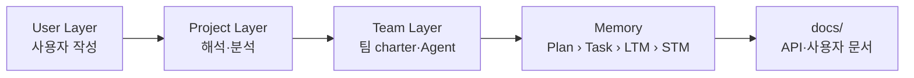

# AI-DLC 사용 설명서

AI-DLC(AI-Driven Development Life Cycle)는 **사용자가 템플릿에 맞춰 문서 4개를 쓰면**, Agent 가 그 문서를 해석해 분석 → 팀 생성 → 계획 → 실행 → 문서화까지 진행하는 개발 방식입니다. Claude Code 의 Subagent · Skill · Hook 만으로 동작하며, 별도 서버나 패키지 설치가 필요 없습니다 (Python 3.10+ 표준 라이브러리).

## 30초 요약

```text
/aidlc-init        → workspace/user/ 에 템플릿 4종 생성
(사용자 문서 작성)  → 개요·기능 요구 / 개발 표준 / 아키텍처 철학 / 데이터 정의
/aidlc-interpret   → 필수 항목 검사 후 Agent 가 해석서 + 질문 목록 작성
/aidlc-analyze     → 비즈니스 모델 · 아키텍처 · 데이터(EDA) 분석
/aidlc-teams       → 필수 6팀 + 조건부 팀 생성 (charter + 팀 Agent)
/aidlc-plan        → Phase 로드맵(Plan) + Task 목록
/aidlc-run N       → Task N개 실행 (STM → 팀 Agent → 리뷰 게이트 → Hook 연쇄 갱신)
/aidlc-docs        → API 있으면 REST API 레퍼런스 자동 생성 + 사용자 가이드
/aidlc-status      → 현재 위치와 다음 명령
```

## 문서 목록

| # | 문서 | 이런 때 읽으세요 |
|---|------|-----------------|
| 1 | [시작하기](01-getting-started.md) | 처음 써 볼 때. 설치 확인부터 첫 Task 실행까지 |
| 2 | [사용자 문서 작성법](02-writing-user-docs.md) | User Layer 4개 문서를 어떻게 채워야 하는지 |
| 3 | [파이프라인 단계별 설명](03-pipeline.md) | 각 명령의 입력·출력·통과 조건 |
| 4 | [팀 운영](04-teams.md) | 17개 팀 카탈로그, 작업/리뷰 모드, 리뷰 게이트 |
| 5 | [메모리 계층과 Hook](05-memory-and-hooks.md) | Plan–Task–LTM–STM 연쇄 갱신 원리 |
| 6 | [API 문서화 (REST)](06-api-docs.md) | OpenAPI → REST API 레퍼런스 생성, RESTful 규약 |
| 7 | [CLI 레퍼런스](07-cli-reference.md) | `aidlc.py`, `openapi_docs.py`, Hook 스크립트 |
| 8 | [문제 해결 & FAQ](08-troubleshooting.md) | 막혔을 때 |
| - | [생성 예시: 챗봇 API 레퍼런스](examples/reference.md) | `/aidlc-docs` 결과물이 어떻게 생겼는지 |

## 계층 한눈에 보기



| Layer | 위치 | 누가 쓰나 |
|-------|------|----------|
| User | `workspace/user/` | **사용자만** |
| Project | `workspace/project/` | 분석 Agent |
| Team | `workspace/teams/`, `.claude/agents/team-*.md` | team-architect |
| Memory | `workspace/memory/` | 오케스트레이터 + Hook |
| Docs | `docs/api/`, `docs/guide/` | docs 팀 (없으면 오케스트레이터) |
