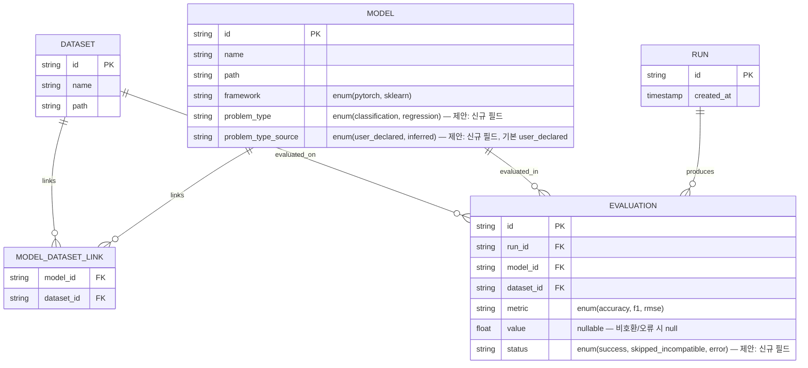

# 30. 데이터 분석 (EDA)

> **가설 기반 분석.** `workspace/data/` 를 확인한 결과(2026-10-26) 실제 DS-01(CSV)/DS-02(모델 스크립트) 샘플 파일이
> 존재하지 않는다. 04-data-definition.md §1 에 명시된 대로 이 프로젝트는 고정 데이터셋이 없고, 사용자가 실행
> 시점마다 임의의 데이터/모델을 업로드하는 구조이므로 사전 EDA 대상 자체가 없다. 따라서 본 문서는 실제 데이터
> 프로파일링 대신 **04§2 의 예상 엔티티·관계를 근거로 한 데이터 모델 제안(§5)과 확보 계획(§6)**에 집중한다.
>
> 다만 00-interpretation.md §3.2 #10 에 남은 설계 과제("지표-문제유형 호환성 검증 규칙 미정")는 데이터가 없어도
> 스키마/로직 차원에서 검증할 수 있으므로, `workspace/project/eda/schema_validation.py` 로 합성(synthetic) 픽스처를
> 만들어 제안한 스키마가 논리적으로 동작하는지 확인했다. 결과는 `workspace/project/eda/summary.json` 에 저장했고,
> 아래 수치는 모두 그 실행 결과를 인용한 것이며 손으로 지어낸 값이 아니다. **이 수치는 실제 업로드 데이터의 통계가
> 아니라 스키마 검증용 가상 샘플의 결과임을 명확히 한다.**

## 1. 데이터 소스 프로파일
| DS | 행/열 수 | 기간 | 결측률 | 중복률 | 주요 타입 | 비고 |
|----|----------|------|--------|--------|-----------|------|
| DS-01 (사용자 업로드 CSV) | N/A (데이터 없음 — 생성 예정) | N/A | N/A | N/A | 업로드 시점까지 미정 | `workspace/data/` 확인 결과 샘플 파일 없음(2026-10-26). 매 실행마다 사용자가 다른 CSV 를 올리므로 "고정 프로파일"이 존재할 수 없는 구조 자체가 설계 전제(04§1) |
| DS-02 (사용자 업로드 모델 스크립트) | N/A | N/A | N/A | N/A | PyTorch 또는 scikit-learn 스크립트 (04§1, 01 FR-002) | 스크립트 호출 인터페이스는 00§3.1 #2 에서 10/20 단계로 위임됨 — 본 문서 범위 아님 |

## 2. 데이터 품질 평가
| 차원 | 상태 (양호/주의/불량) | 근거 | 조치 |
|------|----------------------|------|------|
| 완전성 | N/A | 실제 데이터 없음 | 업로드 시 pydantic 스키마 검증(02 표준)으로 1차 완전성 확보 — FR-002 구현 과제 |
| 정확성 | N/A | 실제 데이터 없음 | 사용자 책임 데이터이므로 시스템은 정확성을 보증하지 않음(04§4 "N/A — 사전 식별 가능한 품질 이슈 없음") |
| 일관성 | N/A | 실제 데이터 없음 | Model.framework(enum), Evaluation.metric(enum) 등 제약으로 업로드 후 일관성만 강제 가능 |
| 적시성 | 해당 없음 | 업로드 즉시 처리되는 1회성 데이터(배치 주기 없음) | — |
| 유일성 | 주의 (설계 시 확인 필요) | Model N─M Dataset 조합이 반복 업로드될 경우 중복 레코드 허용 여부가 04/01 에 명시 안 됨 | 10/20 단계에서 "동일 (model, dataset) 재업로드 시 신규 레코드 vs 갱신" 정책 결정 필요 — STM Task 후보로 남김 |

**데이터 품질 등급(종합): 평가 불가 (N/A)** — 실제 데이터가 없어 등급을 매길 대상이 없음. 등급은 운영 중 실제 업로드가 쌓인 뒤 재평가 필요.

## 3. 주요 관찰 (분포 / 이상치 / 상관)
- 실제 DS-01/DS-02 가 없어 분포·이상치·상관 분석 대상 자체가 없음 (N/A).
- **스키마 검증 결과 (합성 픽스처, 실제 데이터 아님)** — `workspace/project/eda/schema_validation.py` 실행, 결과는 `workspace/project/eda/summary.json`:
  - 제안 스키마(§5) 로 SQLite DDL 생성 성공 (`schema_created: true`).
  - 가상 Model 2개(classification 1, regression 1) × 가상 Dataset 2개 × 지표 선택 5개 조합을 테스트.
  - 호환성 필터 적용 결과: `success_count: 3` (classification+accuracy, classification+f1, regression+rmse), `skipped_incompatible_count: 2` (classification+rmse, regression+accuracy) — 로그에 `WARNING` 2건 기록, 02 표준의 "WARN=선택적 지표 누락" 로깅 규칙과 합치.
  - 결론: Model.problem_type + METRIC_COMPATIBILITY 매핑(§5.2) 조합으로 00§3.2 #10 과제가 스키마 수준에서는 모순 없이 동작함을 확인. (단, 이는 로직 검증일 뿐 실제 사용자 데이터로의 검증은 아님 — 운영 후 재확인 필요)

## 4. 질문별 답변 (user/04 §3)
| # | 질문 | 답 | 근거 (수치/쿼리) | 확신도 |
|---|------|-----|------------------|--------|
| 1 | (04§3: "N/A — 고정 데이터셋이 없어 사전 EDA 대상 데이터가 없음") | 질문 자체가 N/A로 명시됨 — 답할 질문이 없음 | 04-data-definition.md §3 원문 | H |

> 04§3 에 실질적 비즈니스 질문이 없으므로, 본 Agent 가 00§3.2 #10 에서 발견한 "지표-문제유형 호환성" 과제를
> 추가 질문으로 간주해 §5 에서 데이터 모델 차원의 제안으로 답한다 (사용자가 낸 질문은 아니지만, 00 해석서가
> 명시적으로 이 문서에 설계 제안을 요청한 항목).

## 5. 데이터 모델 제안

### 5.1 ERD (04§2 예상 엔티티 + 본 Agent 제안 필드 포함)

04§2 원안과의 차이: ① `Model.problem_type`, `Model.problem_type_source`, ② `Evaluation.status` 3개 필드를
신규 제안했다(아래 5.2 근거). 나머지(Model/Dataset/Run 의 PK·FK 구조)는 04§2 원안을 그대로 따른다.

### 5.2 핵심 설계 과제 — Model 문제 유형(분류/회귀) 식별 & 지표 호환성 (00§3.2 #10)

**결론(제안): `Model.problem_type` 필드를 신설하고, 값은 "모델 출력 형태 추론"이 아니라 "사용자가 업로드 시점에 직접 지정"하도록 한다.**

근거:
1. **추론 방식의 신뢰성 문제** — PyTorch/scikit-learn 모델은 프레임워크·아키텍처가 임의이므로(04§1 "임의의 모델"),
   단일 forward pass 의 출력 shape/dtype만으로 classification(softmax 확률, 로짓, 클래스 인덱스 등 다양한 표현)과
   regression(연속값 1개)을 구분하는 규칙이 일반적으로 성립하지 않는다. 예: 출력이 float 스칼라 1개인 경우
   이진 분류 확률(0~1)인지 회귀값인지 shape만으로 구별 불가능.
2. **아키텍처 우선순위(03, 00§5)** — "1) 단순함 우선, 과설계·조기 분산 금지"가 1위 원칙이고, "개발속도 >
   유지보수성" 이 품질속성 1·2위. 추론 로직(모델을 실제로 1회 실행해 출력을 검사)은 구현 복잡도와 실패
   가능성을 늘리는 반면, 업로드 폼에 라디오 버튼 하나(Classification/Regression) 추가는 "하루" 일정(00§3.2 #9
   리스크)에 맞는 최소 비용 해법이다.
3. **1인·로컬 도구 특성** — NFR-004(동시 사용자 1명), 신뢰 가능한 단일 사용자가 본인 모델의 문제 유형을
   가장 잘 알고 있으므로, 사용자 입력을 신뢰하는 것이 타당하다(이미 04§1 에서 DS-01/02 는 "사용자 본인" 소유로
   신뢰 전제가 있음).
4. 다만 향후 확장을 고려해 `problem_type_source` 필드로 `user_declared`(기본, FR-002 업로드 폼) 와
   `inferred`(향후 자동 추론 추가 시 대비) 를 구분해 두면, 지금은 user_declared 만 쓰면서도 스키마 변경 없이
   추론 기능을 나중에 추가할 수 있다 — 03 의 "과설계 금지"와 "유지보수성" 우선순위를 동시에 만족.

**지표 호환성 필터 — `METRIC_COMPATIBILITY` 매핑 (schema_validation.py 에서 실제 코드로 검증):**

| problem_type | 허용 지표 |
|---|---|
| classification | accuracy, f1 |
| regression | rmse |

- **UI 동작 제안:** FR-003 지표 선택 화면에서 선택된 Model(들)의 `problem_type` 을 조회해, 호환되지 않는 지표는
  체크박스를 비활성화(disable)하거나 목록에서 제외한다. 여러 problem_type 모델이 섞인 Run(혼합 선택)인 경우,
  지표 목록은 선택된 모델들의 허용 지표 **합집합**으로 노출하되, 실제 Evaluation 생성 시점에 각 (model, dataset,
  metric) 조합별로 호환성을 재검사한다.
- **비호환 조합 처리:** Evaluation 레코드는 생성하되 `status='skipped_incompatible'`, `value=NULL` 로 기록하고
  (평가 자체를 생성하지 않고 누락시키면 KPI-02 "입력 모델 수" 집계와 불일치가 생길 수 있어, 레코드는 남기고
  상태로 구분하는 방식을 제안함), 02 표준의 로깅 규칙(WARN=선택적 지표 누락)에 따라 `WARNING` 로그를 남긴다.
  `schema_validation.py` 실행 결과 이 흐름이 제약조건 위반 없이 동작함을 확인했다(§3 참고, `skipped_incompatible_count: 2`).
- **대안으로 검토했으나 보류한 방식:**
  - *(a) 모델 실행 후 출력 형태로 추론* — 위 1번 근거로 신뢰성 부족, 또한 "평가 실행 전" UI 단계에서 필터링이
    불가능해(실행해봐야 알 수 있으므로) FR-003 의 "지표 선택 시점" 요구와 맞지 않음. 보류.
  - *(b) 호환성 검사 없이 전부 허용 후 계산 시 예외처리만* — 00§3.2 #10 이 지적한 문제를 UI 레벨에서 선제
    차단하지 못하고 사용자가 매번 실패를 겪은 뒤에야 알게 됨 — "결과 비교 용이성" 우선순위(03)에 역행. 보류.

**영향받는 FR/영역:** FR-002(업로드 폼에 problem_type 입력 추가), FR-003(지표 선택 UI 필터링), FR-004(Run 생성 시
비호환 조합 처리), 04§2.1(Model 필드 확장) — 10-business-analysis/20-architecture-analysis 단계에서 이 제안을
구체 설계로 반영할 것을 권고.

## 6. 데이터 파이프라인 & 확보 계획
| 단계 | 내용 | 도구 | 주기 | 담당 팀 |
|------|------|------|------|---------|
| 수집 | 웹 UI 에서 CSV(DS-01)/모델 스크립트(DS-02) 업로드, 이때 problem_type(§5.2) 사용자 입력 수집 | FastAPI 업로드 엔드포인트, pydantic 검증 (02 표준) | 사용자 실행 시점마다 | backend |
| 정제 | 업로드 파일 형식 검증(CSV 파싱 가능 여부, 스크립트 framework 식별), 실패 시 HTTPException | pandas(CSV), 정적 검사(스크립트) | 업로드 시 1회 | backend |
| 저장 | Model/Dataset/Run/Evaluation 레코드를 §5 스키마로 SQLite 에 저장, 원본 파일은 로컬 경로(예 `workspace/data/`)에 보관 | SQLite, 로컬 파일시스템 | 업로드/Run 시점마다 | backend / dba |
| 서빙 | Run 결과(Evaluation) 를 pandas 로 조회해 지표 비교·상관관계 그래프 생성(FR-005) | pandas, 서버사이드 렌더링(Jinja2) | 평가 완료 후 요청 시 | backend / frontend |
| (신규) 테스트 픽스처 확보 | 실제 데이터가 없는 사전 개발/QA 단계를 위해, 분류용 소형 CSV(예: iris 유사 합성 데이터)와 회귀용 소형 CSV 1쌍 + 각각에 대응하는 더미 sklearn 모델 스크립트를 QA 팀이 `tests/fixtures/` 에 마련 — 02 표준 "더미 데이터로 테스트" 요구와 직결 | 수동 작성 또는 `sklearn.datasets` 활용 | 개발 착수 시 1회 | qa |

## 7. 기능/KPI 영향
- **FR 별 데이터 의존성:**
  - FR-001(N:M 연결) — Model/Dataset 레코드 존재가 전제. 데이터 없음 상태에서도 스키마(§5)만으로 설계 가능.
  - FR-002(업로드) — problem_type 입력 필드 추가 제안(§5.2)이 폼 설계에 영향.
  - FR-003(지표 선택) — 호환성 필터(§5.2) 가 UI 로직에 직접 영향. **구현 미반영 시 00§3.2 #10 리스크가 그대로 남음.**
  - FR-004(Run 실행) — Evaluation.status 필드 추가 제안이 Run 완료 판정/KPI-02 집계 로직에 영향(아래 참고).
  - FR-005(시각화) — skipped_incompatible 상태의 Evaluation 을 그래프에서 제외하거나 별도 표기할지는 20 단계 과제로 이관.
- **KPI 측정 가능 여부:** KPI-02(동시 평가 가능 모델 수 = 완료 모델 수/입력 모델 수)는 04 Run─Evaluation 관계로
  집계 가능(00§2 FR-004 행 재확인). 다만 `status='skipped_incompatible'` 레코드를 분자(완료)에 포함할지 여부를
  명확히 정의해야 KPI-02 집계가 모호해지지 않음 — **10-business-analysis 단계에서 KPI-02 산식에 "비호환 스킵"
  처리 방식을 명시할 것을 권고** (예: 분모에서 제외, 또는 "완료"가 아닌 별도 카테고리로 분리 집계).
- **개인정보 처리 요구:** 없음. 04§6 "개인정보 포함 여부: 아니오(확인됨)", NFR-005 와 일치. 본 분석 과정에서도
  실제 사용자 데이터를 다루지 않았으므로(샘플 부재) 마스킹 대상 자체가 없었음.
