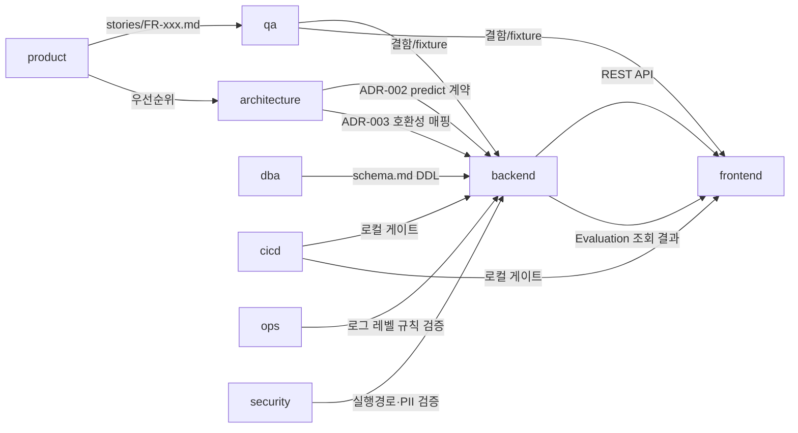

# 40. 팀 구성

> 입력: `aidlc/teams/catalog.json`, 10/20/30 분석서, user/02. core 팀(product, architecture, qa, cicd, ops, security)은 항상 생성.
> 생성한 팀마다 `workspace/teams/<id>/charter.md` 와 `.claude/agents/team-<id>.md` 가 존재해야 합니다.
> frontmatter `teams` 에 생성한 팀 id 목록을 적습니다.

> **프로젝트 메모:** ML_miniops 는 1인·로컬·"하루" 목표 프로젝트(00§6 GO, 01§0)다. core 6팀은 CLAUDE.md 규칙대로 항상 생성하고,
> conditional 팀은 20-architecture-analysis.md §4 컴포넌트 표의 "소유 팀 (예정)" 칸(frontend/backend/dba 만 등장)과
> 30-data-analysis.md §6("data 전담 팀 불필요 — backend/dba 가 흡수")을 근거로 **backend, frontend, dba** 3개만 추가 생성한다.
> 나머지 8개 conditional 팀(design, mobile, integration, data, analytics, ml, infra, docs)은 §2 에 제외 근거와 인수 팀을 명시한다.

## 1. 팀 구성 결정
| 팀 id | 팀명 | tier | 생성 근거 (분석서 § 인용) | 담당 컴포넌트/디렉토리 |
|-------|------|------|--------------------------|------------------------|
| product | Product (PO/PM) | core | 항상 생성 (CLAUDE.md core). 10-business-analysis 전체(KPI 트리 §3, FR 우선순위 §5, MVP §6)의 단일 책임자 | `workspace/project/stories/`, UAT 체크리스트 |
| architecture | Architecture | core | 항상 생성 (CLAUDE.md core). ADR-001~003(20§8), `20-architecture-analysis.md` 유지보수의 단일 책임자 | `workspace/project/20-architecture-analysis.md`, `workspace/project/adr/` |
| backend | Backend | conditional | 20§4 컴포넌트 표: API 라우터·모델 로더/어댑터·호환성 필터·평가 실행기·지표 계산기·데이터 접근 계층(쿼리 구현)·로컬 파일 저장소·실행 런처 = 소유 팀 **backend** (6/9 컴포넌트) | `app/api/`, `app/eval/model_loader.py`, `app/eval/compatibility.py`, `app/eval/engine.py`, `app/eval/metrics.py`, `app/eval/repository.py`(쿼리 구현부), `run.py`, `workspace/data/`(업로드 파일) |
| frontend | Frontend | conditional | 20§4 컴포넌트 표: Web UI(템플릿+JS), 시각화 생성기(`visualize.py`) = 소유 팀 **frontend** | `app/web/`(Jinja2 템플릿, 바닐라 JS, 정적 파일), `app/eval/visualize.py` |
| dba | Database (DBA) | conditional | 20§4 컴포넌트 표: "데이터 접근 계층(Repository)" = 소유 팀 **dba** (SQLite 스키마 관리), 30§5 ERD/스키마 제안이 입력 | `app/eval/repository.py`(스키마·DDL·마이그레이션 설계, 쿼리 구현은 backend 리뷰 대상) |
| qa | QA / Test | core | 항상 생성 (CLAUDE.md core). 모든 코드 변경 Task 의 리뷰 게이트, 30§6 "테스트 픽스처 확보" 담당 팀으로 이미 명시됨 | `tests/`, `tests/fixtures/`(합성 분류·회귀 CSV + 더미 모델 스크립트) |
| cicd | CI/CD (Build & Release) | core | 항상 생성 (CLAUDE.md core). 02§10 공통 DoD(lint/문서/단위테스트)의 로컬 게이트 집행자 | 로컬 게이트 스크립트/체크리스트(원격 CI 파이프라인 없음, §2 참고) |
| ops | Ops / SRE | core | 항상 생성 (CLAUDE.md core). QS-2(재시작 복구), 02§7 로깅 레벨 기준의 운영 관점 검증자 | 런북(재시작 복구, 포트 충돌 등), 02§7 로그 레벨 규칙 검증 |
| security | Security / DevSecOps | core | 항상 생성 (CLAUDE.md core). NFR-003(localhost 바인딩), NFR-005(PII 없음), R2(임의 코드 실행 리스크, 20§9) 검증자 | 위협 모델(threat-model.md), privacy.md |

## 2. 생성하지 않은 팀 & 책임 인수
| 후보 팀 | 제외 이유 (create_when 미충족 근거) | 책임을 넘겨받는 팀 |
|---------|-------------------------------------|-------------------|
| design | create_when "사용자 화면이 있고 흐름이 3단계 이상" 조건 자체는 형식상 충족(10§4 사용자 여정 5단계)하지만, 20-architecture-analysis 가 어떤 wireframe/디자인 토큰/접근성 산출물도 요구하지 않았고(02 Frontend 표준도 "Node 빌드 없음 + 바닐라 JS"로 최소 구성), 03원칙1 "과설계·조기 분산 금지"와 "하루" 일정(00§3.2 #9)상 별도 디자인 단계를 두지 않는 것이 명시적 선택임 | frontend (화면 구성·상태를 직접 FR 수용 기준에서 구현), product (스토리 작성 시 화면 흐름을 함께 정의) |
| mobile | create_when "네이티브/크로스플랫폼 모바일 앱" 자체가 범위에 없음(01/02 Frontend = Jinja2+바닐라 JS, 로컬 웹 전용) | 해당 없음 (아무 팀도 인수하지 않음 — 범위 밖) |
| integration | create_when "외부 시스템 연동이 2개 이상" — NFR-003(localhost 전용, LAN/외부 노출 없음), 03§6 "실행 환경: 로컬 PC"로 외부 시스템 연동이 0개(사용자 업로드 스크립트의 `predict()` 호출은 인프로세스 함수 호출이며 20§4 의도상 "외부 시스템 연동"이 아니라 로더가 흡수) | backend (모델 로더가 ADR-002 계약으로 직접 흡수, 어댑터 패턴 불필요) |
| data | create_when "데이터 소스 1개 이상 + 수집·정제·적재 파이프라인" — 30§6 파이프라인 표가 수집/정제/저장/서빙 단계 모두를 **backend / dba / frontend** 담당으로 이미 명시했고, 04§1·30 전체가 "고정 데이터셋 없음(매 실행마다 사용자가 업로드)"이라 전통적 데이터 파이프라인(배치/CDC/리니지)이 존재하지 않음 | backend(수집·정제·저장), dba(스키마) |
| analytics | create_when "KPI 측정 대시보드나 정기 분석 리포트" — 10§2 "수익원/비용절감효과: N/A, KPI-02 로 간접 추정"이며 별도 BI 대시보드·정기 리포트 요구 없음(01/02/03 어디에도 없음). KPI-02 는 Run/Evaluation 레코드 집계(04, 20§5 `GET /runs/{run_id}/results`)로 충분 | product (KPI-02 해석·UAT 기록), backend/dba (집계 쿼리 제공) |
| ml | create_when "모델 학습·추론, LLM 프롬프트, RAG 검색, 의도 분류 등 AI 품질 관리" — 본 프로젝트는 AI 기능을 직접 만들지 않고 **사용자가 업로드한** 모델을 실행·평가하는 하니스일 뿐이다(01§1, ADR-002). 프롬프트·RAG·학습 파이프라인이 없으므로 evals/ 하네스나 안전성 정책이 적용될 대상이 없음 | backend (평가 실행기·호환성 필터가 "모델 품질 관리"에 해당하는 유일한 로직을 흡수) |
| infra | create_when "클라우드/서버 리소스·네트워크·IaC 관리" — 03§6 "실행 환경: 로컬 PC, IaC 불필요", 클라우드 리소스 0개(10§2 "인프라 비용 없음"). catalog 자체도 "관리형 PaaS 만 쓰면 ops 에 통합 가능"이라고 명시 | ops (로컬 실행 전제·포트·재시작 런북을 흡수) |
| docs | create_when "외부 공개 API, 운영자/관리자 매뉴얼, 사용자 가이드" — 1인 로컬 도구라 외부 공개 API 소비자가 없고, "하루" 일정상 공식 문서화 범위가 사용자 본인이 읽는 최소 사용법 수준으로 제한됨(CLAUDE.md "미생성 시 `/aidlc-docs` 는 오케스트레이터가 직접 수행") | 오케스트레이터 (`/aidlc-docs` 직접 수행, CLAUDE.md 명시), product (기능 설명 정확성 검토 보조) |

## 3. 조직도
```mermaid
flowchart TB
  subgraph 기획·설계
    product[product]
    architecture[architecture]
  end
  subgraph 개발
    backend[backend]
    frontend[frontend]
    dba[dba]
  end
  subgraph 품질
    qa[qa]
  end
  subgraph 플랫폼·운영
    cicd[cicd]
    ops[ops]
  end
  subgraph 보안·거버넌스
    security[security]
  end
```

## 4. 책임 매트릭스 (RACI)
<!-- 열 = 생성된 팀 id. R=수행, A=최종책임(정확히 1팀), C=협의, I=통보 -->
| 산출물/활동 | product | architecture | backend | frontend | dba | qa | cicd | ops | security |
|-------------|---------|--------------|---------|----------|-----|----|------|-----|----------|
| 요구사항·수용 기준 (stories/) | **A/R** | C | I | I | I | C | I | I | I |
| ADR·계약 (adr/, 20-architecture-analysis.md) | C | **A/R** | C | C | C | I | I | I | C |
| 백엔드 구현 (API·평가엔진·모델로더·호환성필터) | C | C | **A/R** | C | C | C | I | I | C |
| 프론트엔드 구현 (Web UI·시각화) | C | I | C | **A/R** | I | C | I | I | I |
| DB 스키마·마이그레이션 (SQLite) | I | C | C | I | **A/R** | I | I | I | I |
| 테스트 전략·검증 (tests/, DoD 게이트) | C | I | C | C | I | **A/R** | C | I | I |
| 빌드·로컬 게이트·릴리스 | I | I | C | C | I | C | **A/R** | I | I |
| 운영·로그·장애 복구 (런북, QS-2) | I | C | C | I | I | I | I | **A/R** | C |
| 보안·개인정보·위협 모델 | I | C | C | C | I | I | I | C | **A/R** |

## 5. 리뷰 게이트
<!-- /aidlc-run 이 Task 완료 후 대상에 해당하면 해당 팀을 리뷰 모드로 호출. catalog.json 의 review_gate 기준 -->
| 리뷰 팀 | 적용 대상 Task | 주요 확인 항목 |
|---------|---------------|---------------|
| product | FR 의 동작을 바꾸는 모든 Task | 결과가 FR 수용 기준(stories/FR-xxx.md)을 충족하는가, In/Out scope(10§6 MVP 정의)를 벗어나지 않았는가 |
| architecture | 새 컴포넌트·외부 의존성·데이터 모델·팀 간 계약을 바꾸는 Task | ADR(ADR-001~003 또는 신규)이 있는가, user/03 원칙·금지 기술을 지켰는가, API 계약 하위 호환성 |
| dba | DB 스키마·마이그레이션·대량 쿼리를 바꾸는 Task | 롤백 가능한가, 락/다운타임 위험(1인 로컬이라 사실상 낮음), 인덱스 적절성 |
| qa | 코드를 변경하는 모든 Task | DoD(02§10 + 팀 DoD) 충족, 수용 기준 대응 테스트 실행·통과, 회귀 없음, 엣지/오류 케이스(비호환 지표, 잘못된 predict 계약 등) |
| cicd | 빌드 설정·의존성·로컬 게이트 스크립트를 바꾸는 Task | 로컬 게이트(ruff·pytest)가 통과하는가, 빌드 재현 가능한가 |
| ops | 배포 방식·설정·로그 계측을 바꾸는 Task | 02§7 로그 레벨 규칙 준수, 재시작 후 데이터 보존(QS-2) 확인 |
| security | 업로드·실행·개인정보·외부 노출 경로를 다루는 Task | NFR-003(127.0.0.1 바인딩) 준수, 비밀값·PII 미노출, 임의 코드 실행 리스크(R2) 완화 문구 유지 |

> backend/frontend 는 catalog 상 review_gate 가 없다(다른 팀을 리뷰하지 않음) — 구현 팀이며, 이들의 변경은 위 7개 리뷰 팀이 검증한다.

## 6. 팀 간 인터페이스 (계약)
| 제공 팀 → 사용 팀 | 인터페이스 | 형식 | 계약 문서 위치 |
|-------------------|-----------|------|----------------|
| architecture → backend | `predict(X) -> y` 모델 호출 계약 | Python 함수 시그니처 (ADR-002) | `workspace/project/adr/ADR-002-model-invocation-contract.md` |
| architecture → backend | `problem_type` ↔ `METRIC_COMPATIBILITY` 호환성 규칙 + KPI-02 산식 | 매핑 테이블 + `Evaluation.status` enum (ADR-003) | `workspace/project/adr/ADR-003-metric-problem-type-compatibility.md` |
| backend → frontend | REST API (`POST /models`, `POST /datasets`, `POST /links`, `GET /links`, `POST /runs`, `GET /runs/{run_id}/results`) | JSON / multipart, FastAPI 자동생성 OpenAPI 문서(02§6 — 별도 `contracts/*.yaml` 작성하지 않음) | `workspace/project/20-architecture-analysis.md` §5 (계약 원천), 런타임 `/docs` |
| dba → backend | SQLite 스키마(DDL), ERD | `CREATE TABLE` 문, `schema.md` | `workspace/teams/dba/charter.md` §3, `app/eval/repository.py` 상단 DDL |
| backend → frontend | 시각화용 Evaluation 레코드 조회 결과 | pandas DataFrame → `GET /runs/{run_id}/results` JSON/HTML | `20-architecture-analysis.md` §5 |
| product → qa | 수용 기준 (Given/When/Then) | `stories/FR-xxx.md` | `workspace/project/stories/` |
| qa → backend/frontend | 결함(버그) 리포트, 테스트 픽스처 | `tests/fixtures/`(합성 CSV+모델), STM §5 Task 후보 | `tests/fixtures/`, `workspace/memory/short-term.md` |

## 7. 팀 의존 그래프


## 8. 팀별 초기 책임 FR / NFR
| 팀 | FR / NFR | 첫 Phase 목표 |
|----|---------|---------------|
| product | FR-001~005, KPI-01/02 | P1: 전체 FR 스토리·수용 기준 작성 (10§6 MVP 정의 그대로) |
| architecture | ADR-001(완료)~003(완료), FR-002/003 설계 근거 유지 | P1: 신규 설계 과제 발생 시 ADR 추가(현재 ADR-001~003 로 충분) |
| backend | FR-001(링크 API), FR-002(업로드+모델로더), FR-003(호환성 필터 구현), FR-004(Run 실행기), NFR-001/002/003(바인딩)/004 | P1: FR-001/002/004 핵심 파이프라인 (10§6 Fallback 완화안과 합치) |
| frontend | FR-001(연결 화면), FR-002(업로드 폼), FR-003(지표 선택 UI), FR-004(Run 버튼), FR-005(결과 시각화) | P1: FR-001/002/004 화면 + 최소 결과 표. P2: FR-003 필터 UI 고도화, FR-005 상관관계 그래프(10§5) |
| dba | FR-001(Model-Dataset-Link 스키마), FR-002(Model/Dataset 테이블), FR-003(Evaluation.metric enum), FR-004(Run/Evaluation + status enum) | P1: 30§5.1 ERD 그대로 DDL 확정 (Model.problem_type, Evaluation.status 포함) |
| qa | FR-001~005 전체 | P1: 더미 분류/회귀 fixture 마련(30§6) + FR-001/002/004 E2E, P2: FR-003/005 보강 테스트 |
| cicd | 02§10 공통 DoD 게이트 | P1: ruff + pytest 로컬 게이트 스크립트/체크리스트 확정 |
| ops | NFR-002(재시작 복구), 02§7 로깅 | P1: 재시작 복구 런북(QS-2), 로그 레벨 규칙 검증 체크리스트 |
| security | NFR-003/005, R2(20§9) | P1: threat-model.md(STRIDE 간략), privacy.md(PII 없음 확인 근거) |
